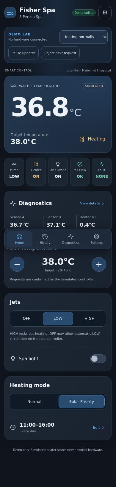
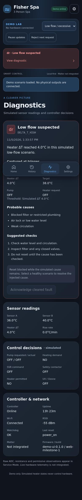

# Demo web app milestone 1

## Run locally

From the repository root:

```sh
python3 -m http.server 8080 --directory firmware/data
```

Open **http://localhost:8080/**. No controller, backend, npm install or build step is required to run the app. Serve the directory; ES modules do not reliably load through `file://`.

Production assets are the six static files under `firmware/data/`: `index.html`, `styles.css`, `app.js`, `model.js`, `services.js`, `views.js`. No fonts, scripts, icons or APIs are downloaded from a CDN. JavaScript and CSS are plain source; there is no framework runtime or bundler.

## Run tests

Node.js 22+:

```sh
npm test
npm run size
npm install
npx playwright install chromium
```

With the static server running in another terminal:

```sh
npm run test:browser
```

`APP_URL` can change the URL (include the trailing slash). `CHROMIUM_PATH` can select an installed Chromium executable. Browser tests also accept `PLAYWRIGHT_MODULE` as a module URL when using an existing installed dependency. The browser suite generates `docs/screenshots/home.jpg`, `docs/screenshots/diagnostics.jpg` and ignored `artifacts/browser-results.json`.

Firmware tests/builds remain separate: see `firmware/README.md`. No UI command flashes firmware or writes a physical output.

## State and service boundary

`model.js` defines the contract-shaped state, request validation, UI limits and 12 scenario fixtures. `app.js` owns one current view-model state, applies received service snapshots and renders all screens from that object. `views.js` contains rendering and escapes untrusted text. A serialized pending-command guard prevents double submissions; revision checks discard outdated polls. No screen optimistically treats a submitted command as applied.

`DemoSpaService` is the default and only instantiated service. Its independent request guards reject fault/service/offline starts, maintain bounded session history, return detached snapshots and store persistent **demo-only Service Mode** in browser localStorage. Selecting a scene changes the synthetic controller state; it is not a firmware safety qualification. Healthy scene selection clears injected faults; explicit persistent Service Mode still requires an exit. The Watchdog scene requires fault acknowledgement before service exit.

`HttpSpaService` implements the *planned* JSON routes in `API_CONTRACT.md`, with request validation, an abort timeout, explicit acknowledgement and authoritative state refresh. It is exported/tested but not selectable from the normal demo UI. It does not call V0.6.2 `/api/cmd`, translate GPIO commands, or assume `NORMAL` equals manual heat. HTTP read/command errors remain visible and stale/offline states disable requests.

All normal requests are high-level target/jets/light/heating-mode/schedule actions. Service entry/exit and fault acknowledgement require a confirmation dialog. No commissioning output tests are present.

## Implemented screens

- **Home:** water/target temperature, simulated heating status, five status tiles, sensor summary, bounded target controls, jets, light, heating mode and schedule.
- **History:** bounded session event/fault list with captured detail dialogs.
- **Diagnostics:** live synthetic readings, logical control decisions, reset/network/watchdog status, detailed active fault and captured values/causes/checks. Raw/permissive observations appear only during Service Mode and unavailable hardware data is labelled unavailable.
- **Settings:** schedule times/weekdays, heating mode, limits/units, controller-managed UV behavior, persistent demo service controls, firmware/build and explicit pending connection features.

The demo toolbar provides all 12 handoff scenarios, paused updates to exercise stale-data behavior and a reject-next-request control. All are clearly marked demo-only. Matter is always labelled unimplemented rather than pretending to be paired.

## Reconciliation and deferred integration

1. Imported reviewed V0.6.2 firmware and corrected historical repository mapping documents to match it. No relay assignment in the reviewed source changed. Both heater pins remain inhibited. Earlier GPIO16 SSR proposals are superseded, not silently implemented.
2. Current firmware serves `/api/status`, `/api/events`, form-encoded `/api/cmd`; it does not yet serve these static assets or the planned rich JSON API. Future integration needs bounded static-file serving, capabilities/version negotiation and an explicitly reviewed API adapter.
3. Default demo schedule is **11:00–16:00**, matching the established firmware. Old 09:00–15:30 examples are documentation examples. UI minute/day scheduling is future contract functionality; current firmware has hour-only windows and no weekday selector.
4. UI target limits are 20–40°C in 0.5°C steps for this milestone. Firmware accepts its own validated range; live capabilities must eventually be obtained from the controller.
5. Service payload/acknowledgement details absent from the initial API brief are documented in `API_CONTRACT.md`; persistence in this milestone is browser-local only, never a claimed controller write.
6. Theme is dark and units fixed Celsius. Wi-Fi setup, Matter pairing/reset and history clearing have no implemented controller endpoint and remain labelled pending rather than offering fake actions. Demo history is session-only and bounded to 50 records.
7. No Matter, VL260 decoding, M7 ADC changes, dosing, OTA, cloud, mains commissioning or hardware output controls were implemented in the UI milestone. The simulator is not a physics model or certified M7 algorithm.

## Visual reference and screenshots

The existing Fisher Spa phone concept informed the dark rounded cards, temperature hero, status tiles, blue controls and navigation. Screenshot evidence is captured from the running implementation, not generated mockups.




